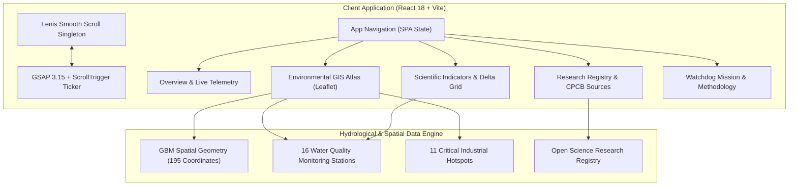

<div align="center">

# Free The Ganges (गंगा मुक्ति)
### Environmental Intelligence Platform & Open Hydrological Watchdog

An open-source digital twin, geospatial environmental atlas, and scientific telemetry platform monitoring the transboundary **Ganges-Brahmaputra-Meghna (GBM)** river basin across India and Bangladesh.

[](https://vitejs.dev/)
[](https://react.dev/)
[](https://www.typescriptlang.org/)
[](https://tailwindcss.com/)
[](https://leafletjs.com/)
[](https://gsap.com/)
[](https://github.com/darkroomengineering/lenis)
[](https://vitest.dev/)
[](scripts/validate-basin-data.ts)
[](LICENSE)

</div>

---

## 🌊 Overview

The **Ganges-Brahmaputra-Meghna (GBM)** river system is one of the most critical transboundary hydrological basins on Earth, sustaining more than 600 million people across South Asia. Rapid urban industrialization, agricultural runoff, municipal sewage discharge, and climate-induced flow variations pose existential threats to its biodiversity and water security.

**Free The Ganges** is an independent, community-driven environmental watchdog platform that provides transparent, verifiable, and open-access data to researchers, policymakers, journalists, and civic activists. The platform combines interactive cartography, continuous water quality telemetry, comparative station analysis, and open research repositories.

---

## ⚡ Key Capabilities

### 1. Interactive GIS Environmental Atlas (`/atlas`)
- **Spatial Coverage**: Strict WGS 84 (EPSG:4326) bounds covering 20°N to 32°N and 73°E to 98°E.
- **Cartographic Layers**: 15 major river tributaries, 11 high-priority pollution hotspots, 16 water quality monitoring stations, industrial effluent zones, and ecologically sensitive wetlands (Sundarbans).
- **Responsive Navigation**: Full-bleed responsive map canvas on desktop and mobile with an interactive 3-tab segmented bottom dock (`[Map Canvas]`, `[Layers & Filters]`, `[Location Dossier]`) and non-obstructive slide-over drawers.
- **Gesture Isolation**: Leaflet map touch and wheel events isolated via `data-lenis-prevent` to prevent scroll interference.

### 2. Scientific Telemetry & Basin Indicators (`/indicators`)
- **Key Water Quality Parameters**: Real-time tracking of Dissolved Oxygen (DO), Biochemical Oxygen Demand (BOD), Fecal Coliform, Heavy Metal Index, and Flow Discharge rates.
- **Multi-Location Delta Variance**: Pairwise station comparison across key metropolitan hubs (Kanpur, Varanasi, Patna, Dhaka, Kolkata) calculating absolute and percentage variances against safe ecological thresholds.
- **Scientific Data Table**: Sortable and filterable telemetry data records exportable for hydrological modeling.

### 3. Open Science & Research Registry (`/research`)
- Searchable repository of peer-reviewed water governance studies, Central Pollution Control Board (CPCB) bulletins, and Bangladesh Water Development Board (BWDB) reports.
- Source transparency linking directly to primary datasets, DOI citations, and methodology whitepapers.

### 4. High-Performance Motion & Responsive Architecture
- **Lenis Smooth Scroll**: Unified window scroll listener synchronized directly with GSAP's requestAnimationFrame ticker.
- **GSAP ScrollTrigger**: Custom `useScrollReveal` hook utilizing `gsap.context()` for memory-safe entrance and reveal animations.
- **Accessibility & Anti-Slop**: Strict compliance with `prefers-reduced-motion`, zero purple-blue cliches, zero emoji icons (all clean Lucide React SVGs), and WCAG AA contrast standards.

### 5. Midnight Terminal Design System
- **Dark Layered Surfaces**: Void (`#0b0c0e`), Abyss (`#0e111b`), Deep Sea (`#0d172b`), and Cobalt Panel (`#12244f`).
- **Precision Typography**: Standardized on **Plus Jakarta Sans** for headlines and body text, paired with **IBM Plex Mono** for coordinates and scientific metrics.
- **Hairline Geometry**: 12px rounded cards (`rounded-xl`), hairline borders (`#182234`, `#233354`), and 9999px pill buttons for interactive controls.

---

## 🛠️ Architecture & Tech Stack



| Layer | Technologies |
|---|---|
| **Core Framework** | React 18, TypeScript 5.7, Vite 6 |
| **Styling & Design** | Tailwind CSS 3.4, PostCSS, Lucide React Icons |
| **Mapping & GIS** | Leaflet 1.9, React-Leaflet, EPSG:4326 (WGS 84) CRS |
| **Animations** | GSAP 3.15, GSAP ScrollTrigger, Lenis 1.3 Smooth Scroll |
| **Charts & Analytics** | Recharts 2.15, Custom SVG Basin Flow Schematics |
| **Testing & Quality** | Vitest 5.1, React Testing Library, JSDOM, TSX validation runner |

---

## 📂 Project Directory Structure

```
freetheganges/
├── public/                 # Static assets, favicon, and _redirects for SPA routing
├── scripts/
│   └── validate-basin-data.ts  # Geospatial coordinate bounding box validator
├── src/
│   ├── components/
│   │   ├── about/          # Watchdog mission, basin context, methodology
│   │   ├── atlas/          # Leaflet GIS canvas, filter panel, inspector dossier
│   │   ├── indicators/     # Water quality charts, comparative delta matrix
│   │   ├── layout/         # Header, footer, alert ticker, methodology modal
│   │   ├── overview/       # Hero section, live basin map, metric panels grid
│   │   └── research/       # Publication cards, filterable research hub
│   ├── data/               # Geospatial coordinates, stations, hotspots, research data
│   ├── tests/              # 9 comprehensive Vitest suites (95 tests)
│   ├── types/              # Strict TypeScript definitions & domain interfaces
│   ├── utils/              # Smooth scroll singleton, GSAP hooks, math helpers
│   ├── App.tsx             # Root component with view routing & Lenis integration
│   ├── index.css           # Custom theme tokens & Tailwind directives
│   └── main.tsx            # Application entry point
├── vercel.json             # Vercel SPA rewrite & header configuration
├── tailwind.config.js      # Tailored Plus Jakarta Sans & AgentQL dark theme palette
├── package.json            # Scripts & dependencies
└── tsconfig.json           # Strict TypeScript configuration
```

---

## 🚀 Getting Started

### Prerequisites
- **Node.js**: v18.0.0 or higher (compatible with Node.js v20 and v24)
- **Package Manager**: [pnpm](https://pnpm.io/) (recommended), npm, or yarn

### 1. Clone the Repository
```bash
git clone https://github.com/DqrknessID/freetheganges.git
cd freetheganges
```

### 2. Install Dependencies
```bash
pnpm install
```

### 3. Start Development Server
```bash
pnpm dev
```
Open [http://localhost:5173](http://localhost:5173) in your browser.

---

## 🧪 Testing & Verification

The project enforces strict automated quality gates. Every release is verified against unit tests, integration suites, and spatial coordinate bounds:

```bash
# Run the complete automated test suite (95 Vitest tests)
pnpm test

# Validate 195 GIS coordinates against the GBM basin envelope
pnpm run test:data

# Run TypeScript typecheck and production build
pnpm run build

# Preview production build locally
pnpm run preview
```

### Test Coverage Highlights
- **Spatial Bounding Checks**: Strict verification of river polylines, monitoring stations, and urban coordinates within `[20°N–32°N, 73°E–98°E]`.
- **Component Lifecycle & Gestures**: Leaflet mounting, smooth scroll ticker cleanup, and mobile responsive drawer state persistence.
- **Scientific Calculations**: Validation of delta variance formulas, parameter threshold ratings, and water quality index math.

---

## 🌐 Deployment

The application is pre-configured for seamless single-page application (SPA) deployment on **Vercel**, **Netlify**, or **Cloudflare Pages**:

- **Vercel**: Configuration handled via [`vercel.json`](vercel.json) with client-side rewrites to `index.html`.
- **Netlify / GitHub Pages**: SPA fallback supported via [`public/_redirects`](public/_redirects).
- **Node v24 Build Allocation**: Build script utilizes `--stack-size=4096` to guarantee reliable Rollup AST generation across all OS environments.

---

## 📜 Scientific Standards & Data Sources

All telemetry models and geographical representations are referenced from open public data and academic publications:
- **Central Pollution Control Board (CPCB)**, Government of India — Real-time River Water Quality Bulletins.
- **Bangladesh Water Development Board (BWDB)** — Hydrological Discharge & Salinity Records.
- **National Mission for Clean Ganga (NMCG)** — Namami Gange Project Datasets.
- **OpenStreetMap & HydroSHEDS** — River network topography and digital elevation baselines.

---

## 🤝 Contributing

Contributions are welcomed! Whether you are a hydrologist, GIS developer, frontend engineer, or environmental researcher:
1. Fork the repository.
2. Create your feature branch (`git checkout -b feat/new-indicator-station`).
3. Ensure all tests and data validations pass (`pnpm test && pnpm run test:data`).
4. Commit your changes (`git commit -m 'feat: add Son river tributary monitoring station'`).
5. Push to your branch (`git push origin feat/new-indicator-station`).
6. Open a Pull Request.

---

## 📄 License

This project is licensed under the **MIT License** — see the [LICENSE](LICENSE) file for details.

---

<div align="center">
<b>Free The Ganges</b> · Dedicated to transparent environmental data for transboundary river conservation.
</div>
